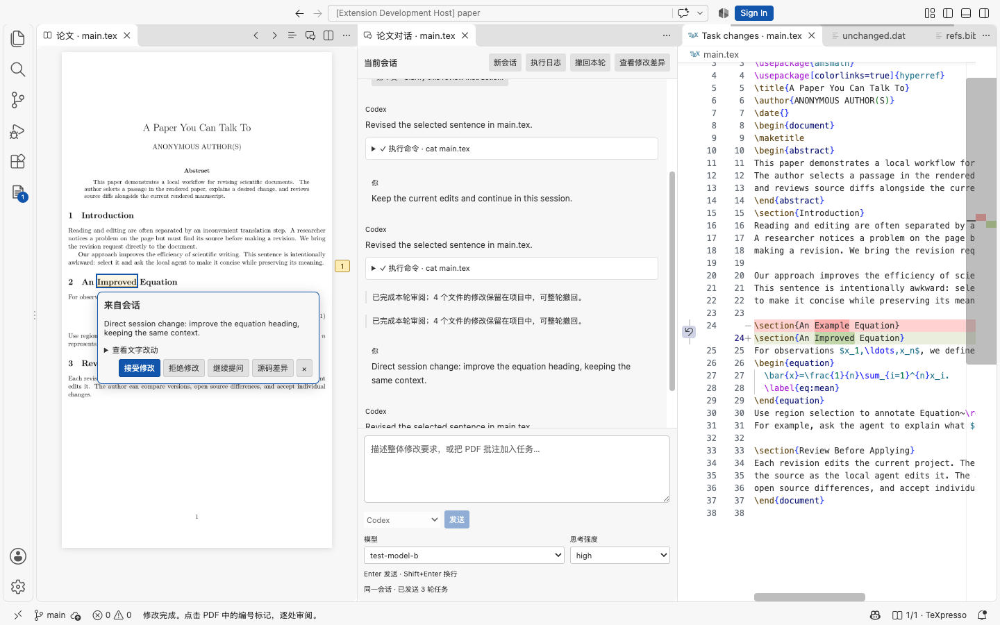
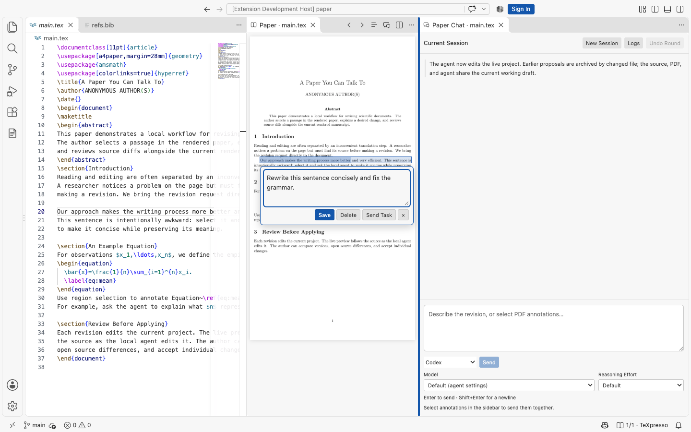
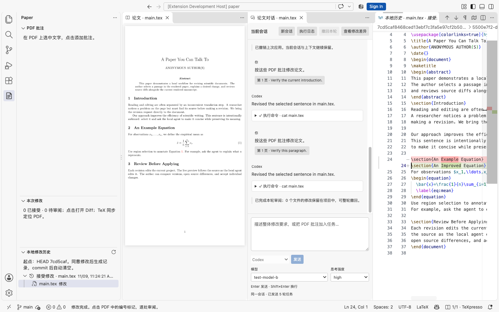
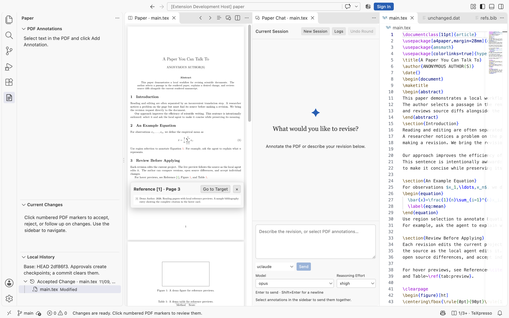

# PDF Local Copilot

**Annotate the PDF. Talk to your local agent. Review the changes in VS Code.**

English | [简体中文](README.zh-CN.md)

[](https://github.com/wyxu95/pdf-local-copilot/actions/workflows/ci.yml)

PDF Local Copilot is a VS Code extension for revising LaTeX papers with your installed **Codex or Claude Code CLI**. Read the rendered paper, attach a request to a passage or figure, and review the resulting edits beside a live [TeXpresso](https://github.com/let-def/texpresso) preview.

The workflow is inspired by [Papilot](https://github.com/PapilotAI/papilot): revision requests belong next to the passage you are reading. This project brings that interaction into VS Code, with local CLI sessions and native editor groups, trees, diffs, menus, and output panels.



*A conversation request becomes a source diff and a PDF highlight. The card links the change to its request and offers accept, reject, and follow-up actions.*

## What you can do

- **Annotate the rendered paper.** Select text or draw a region around an equation or figure. Write the request directly below the selection and click **Send Task** (Send task).
- **Copy readable text.** Ligatures such as `tt`, `ff`, and `ffi` retain their letters when copied. Selection uses one uniform highlight layer.
- **Chat without an annotation.** A request in the paper conversation enters the same review flow. Changes made this way are marked **From Conversation** (From conversation).
- **Keep one agent conversation.** Follow-up tasks queue in the current Codex or Claude session. Choose a model and reasoning effort for each turn.
- **Edit and preview the same files.** The agent works in the real project directory. TeXpresso updates the current paper, including unsaved LaTeX edits.
- **Preview references as you read.** Hover a citation or Figure/Table link to see the rendered entry, figure, or table in a local popup.
- **Review changes individually.** Text files open in VS Code's native Diff editor. TeX edits also highlight the corresponding rendered text. Checkboxes select changes; the checkmark accepts the selection.
- **Keep local approval history.** Each approval operation creates one read-only checkpoint. A Git commit clears this local history and starts a new scope.

The source, PDF, and conversation occupy separate, resizable editor groups. Opening files or Git diffs while chatting routes those file tabs back to the source group.

## See the workflow

### 1. Put the request next to the text



Select a passage, click **Add Annotation** (Add note), and describe the change. **Send Task** saves and submits that annotation immediately. To combine several annotations with an overall instruction, select them in the **PDF Annotations** sidebar and use its send button.

### 2. Continue the conversation and review the result

The conversation streams replies, tool calls, and command output. **Enter** sends a chat message; **Shift+Enter** inserts a newline. New tasks wait in the same session when the agent is busy.

Click a change in **Current Changes** (Current changes) to open its source diff. Click a PDF change marker to see the originating annotation or conversation request. The review card supports **Accept Change** (Accept), **Reject Change** (Reject), and **Follow Up** (Follow up).

Each turn compares against the working draft immediately before that turn. Accepting a change confirms the current edit; rejecting it restores that part of the source. Accepted entries and their PDF decorations leave the pending list.

Git commits also confirm the changes they contain. Committed edits automatically
leave **Current Changes** and their PDF decorations are cleared. Partial staging
confirms only the committed portion; other edits and files remain pending. These
confirmations preserve the working files and the original annotation links.

### 3. Browse the versions you approved



Expand **Local History** (Local change history), then click a file under a checkpoint. Its historical diff is read-only, while the manuscript and PDF continue to show the current working draft.

One batch approval creates one checkpoint containing the accepted changes. Saving, agent completion, and rejection create no checkpoints. History covers the current Git HEAD scope; a new commit clears the old checkpoint files and closes their historical diff tabs. **Undo Round** (Undo this round) separately restores a round after checking for later edits.

*Screenshots show the included demo paper in an isolated development workspace. Agent replies are produced by the deterministic test CLI. The interface defaults to English; authored annotations and agent output retain their original language.*

### Preview citations and floats



Hover a linked citation number, Figure number, or Table number to open a preview
of its target from the current rendered document. Move into the popup to inspect
it; long previews scroll inside the popup. Moving away or pressing **Escape**
closes it. Click the reference or **Go to Target** to navigate to its page.
**Ctrl/Cmd+click** continues to open the corresponding LaTeX source.

Previews use the document's internal hyperlinks, typically produced by
`hyperref`. Bibliography entries and float regions are cropped from the local
rendered page. Editing or rebuilding the paper refreshes the preview cache.
Each number in a grouped citation has its own target. Preview content keeps the
paper's current display scale; a full-width figure or reference occupies its
rendered line width. Wide content scrolls horizontally within a narrow editor.
The preview region is rendered again at the display's pixel density, including
Retina screens. Zooming creates a sharper render at the new size.

## Build and install

Release packages target **macOS Apple Silicon**, **Ubuntu 24.04 x64**, and **Ubuntu 24.04 ARM64**. Windows VS Code uses its WSL2 or Remote SSH workspace host to run the backend. Choose the VSIX for that host; the PDF, chat, and native VS Code components remain in the Windows window. See the [Windows and remote installation guide](docs/windows-remote.md).

Native binaries link against the target host's libraries. The Git repository contains the extension source and the TeXpresso patches; `vendor/`, `native/`, and generated VSIX files are local build outputs.

### Prerequisites

- VS Code 1.96 or later and Git on the workspace host. Source builds also use Node.js 22 or later, npm, and a C/C++ toolchain with Make.
- TeX Live or MacTeX, including `latexmk`, `synctex`, `kpsewhich`, and the engines/packages used by your paper. Bibliography builds use the installed BibTeX or Biber.
- Codex CLI or Claude Code CLI, installed and authenticated independently.
- TeXpresso's native dependencies. On macOS, the tested dependency setup uses Homebrew:

```sh
brew install mupdf-tools sdl2 pkgconf harfbuzz freetype graphite2 fontconfig libpng icu4c@78
```

The existing native build was validated with MuPDF 1.25.2 and ICU 78.3. See the pinned upstream [build instructions](https://github.com/DominikPeters/texpresso/blob/df8b0941ef19b36377014d18a9a264f3591280b1/INSTALL.md) for dependency details and other environments.

Ubuntu 24.04 runtime dependencies and installation steps are in the [remote guide](docs/windows-remote.md). For a source build, install the packages listed in `scripts/linux-build-packages.txt` with your system package manager.

### Build a VSIX

```sh
git clone https://github.com/wyxu95/pdf-local-copilot.git
cd pdf-local-copilot
npm ci
npm run native:build
npm run check
npm run package
code --install-extension artifacts/pdf-local-copilot-0.8.3-darwin-arm64.vsix
```

### Download a release

Open [Releases](https://github.com/wyxu95/pdf-local-copilot/releases/latest), download
the `.vsix` under **Assets**, and install it with **Extensions: Install from VSIX…**.
Choose `darwin-arm64`, `linux-x64`, or `linux-arm64` to match the workspace host.
Connect the window to WSL or SSH before installing a remote package. Run
**PDF Local Copilot: Check Setup** to inspect the backend host and its tools.

Pushing a version tag matching `package.json`, such as `v0.8.3`, runs the
[Release workflow](.github/workflows/release.yml): it checks TypeScript, builds
the native engines, tests the Linux backends, and uploads each VSIX directly to
a draft GitHub Release. The release becomes public after every target succeeds.
Release notes come from `docs/releases/<tag>.md` when available. Release-candidate
tags containing `-rc.` keep their release in draft for validation.

Open your paper's project folder, trust the workspace, and open the main `.tex` file. Click **PDF Local Copilot: Open Paper** in the editor title bar. The extension opens the current PDF to the right of the source, followed by the paper conversation.

An existing PDF can also be opened with **Open With… → Paper PDF Annotations**. Main-file discovery supports a matching `.tex` filename and `% !TeX root = …` directives.

### Update an installed copy

After pulling changes, rebuild with `npm ci`, `npm run native:build`, and `npm run package`. Install the newly generated VSIX and run **Developer: Reload Window** to activate it. `npm run build` is also used by the F5 extension-development configuration in [.vscode/launch.json](.vscode/launch.json).

For a Mac used both directly and through Remote SSH, install and verify the same
build in both extension stores with
`npm run install:mac -- artifacts/pdf-local-copilot-0.8.3-darwin-arm64.vsix`.
Reload both windows. **Check Setup** reports the version and installation path
used by each window.

## Agents, models, and profiles

Use the agent selector below the conversation, then choose a model and reasoning effort. **Other model** accepts a CLI-supported model name. Codex suggestions come from its local model cache; Claude suggestions include aliases and models from the selected profile. The CLI remains responsible for model availability and authentication.

A named Claude agent can use its own configuration directory. For example, create `uclaude` with `~/.claude-uni` through **＋ Add Claude Agent…**, or configure:

```json
{
  "pdfLocal.agents": [
    {
      "name": "uclaude",
      "type": "claude",
      "claude_config_dir": "~/.claude-uni"
    }
  ],
  "pdfLocal.codexPath": "codex",
  "pdfLocal.claudePath": "claude"
}
```

Custom agents can also specify a `command`. Keep the configuration-directory spelling consistent with your terminal setup, including symlink paths. Agent/profile identity is bound to the conversation; model and effort can change between queued turns.

The revision prompt includes the current project path, the author's instruction, selected PDF text, source context, and available selection screenshots. It also requests the optional **SE-paper-revising** skill at `<agent-config>/skills/paper-review/SKILL.md`. The skill is user-installed; when unavailable, the prompt asks the agent to report that and continue with the request. The complete prompt template is in [src/agent.ts](src/agent.ts).

Local CLIs use their own configured model providers. Extension orchestration and project history run locally; provider requests follow the CLI's account and configuration.

## Rendering and navigation

- **Live preview:** TeXpresso's modified XeTeX engine, `texpresso-xetex`, incrementally renders the working document.
- **Complete builds:** `latexmk -pdfxe` resolves references and bibliographies. A main-file directive such as `% !TeX program = pdflatex` or `lualatex` selects the corresponding full-build path. Project `.latexmkrc` files are supported.
- **PDF → source:** Ctrl+click near rendered text; Cmd+click also works on macOS.
- **Source → PDF:** use **Go to PDF Location** in the TeX editor context menu.
- **Reading:** continuous pages with a 5 px gap, cropped horizontal whitespace, zoom, and fit-to-width.

Text that can be mapped to the current PDF receives review highlights. Edits to BibTeX, Markdown, code, invisible LaTeX commands, or removed text remain available in source diffs. Problems and Output expose compiler diagnostics.

Optional commands before `latexmk` can be configured as `pdfLocal.buildSteps`:

```json
{
  "pdfLocal.buildSteps": [
    { "command": "python3", "args": ["scripts/make_figures.py"] }
  ]
}
```

`${workspaceFolder}` resolves to the real project directory. An external `pdfLocal.texpressoPath` should point to a compatible patched headless build.

## TeXpresso integration

TeXpresso is maintained as a **pinned upstream revision plus tracked patches**. A clean clone can recreate the modified engine with `npm run native:build`.

| Location | Role |
| --- | --- |
| [scripts/build-native.mjs](scripts/build-native.mjs) | Fetches revision `df8b0941ef19b36377014d18a9a264f3591280b1` from the DominikPeters headless fork, checks/applies the patches, and builds the engine |
| [scripts/texpresso-text-layer.patch](scripts/texpresso-text-layer.patch) | Exports bounded character geometry through three frontend C files |
| [scripts/texpresso-pdf-links.patch](scripts/texpresso-pdf-links.patch) | Exports internal links and named destinations from the PDF backend for reference previews |
| [scripts/texpresso-link-geometry.patch](scripts/texpresso-link-geometry.patch) | Uses text-character quads for tight DVI link regions, separating adjacent citation numbers |
| [scripts/texpresso-unicode.patch](scripts/texpresso-unicode.patch) | Decodes multi-letter XDV glyph names such as `t_t` and `f_f_i` into selectable Unicode text |
| [scripts/texpresso-format-cache.patch](scripts/texpresso-format-cache.patch) | Coordinates concurrent cold starts and atomically publishes shared TeX format files |
| `vendor/texpresso/` | Generated, ignored upstream source checkout |
| `native/` | Generated binaries, copied TeXpresso license, and build provenance |
| [src/live.ts](src/live.ts) | Starts and communicates with the headless renderer |

See [docs/texpresso.md](docs/texpresso.md) for the exact source boundaries and patch-verification commands.

## Project data

Annotations, conversations, review patches, sparse undo backups, image attachments, and build caches live under your paper project's `.pdf-local-copilot/`. Add that directory to the paper's `.gitignore`:

```gitignore
.pdf-local-copilot/
```

The agent edits the real project files. Review backups retain old contents only for changed files. Approval history stores text patches and changed binary content; Git-ignored files and generated LaTeX outputs are filtered. See the [Chinese guide](README.zh-CN.md#项目内存储与迁移) for the directory layout and migration behavior.

## Development and tests

```sh
npm ci
npm run native:build
npm run check
npm test
npm run test:ui
```

The full suite includes real TeXpresso/TeX Live rendering, SyncTeX, bibliography builds, local history, undo, and deterministic CLI integration. UI tests launch VS Code with isolated user-data and extensions directories. The UI harness currently uses standard macOS VS Code and MacTeX paths. Screenshots are written to `output/playwright/`.

To test the packaged extension:

```sh
npm run package
PDF_COPILOT_VSIX=artifacts/pdf-local-copilot-0.8.3-darwin-arm64.vsix npm run test:ui
```

The GitHub workflow checks TypeScript, bundles the extension, and runs a selected native-independent test set. Full rendering/UI verification requires the native engine and TeX installation described above.

## Credits and licenses

- **[Papilot](https://github.com/PapilotAI/papilot)** inspired the PDF annotation → agent revision → review interaction. Thank you to the Papilot team for making the paper itself a useful place to express revision requests.
- **[TeXpresso](https://github.com/let-def/texpresso)** by let-def and its contributors supplies the incremental rendering engine. **[DominikPeters' TeXpresso fork](https://github.com/DominikPeters/texpresso/tree/vscode)** supplies the pinned headless/VS Code integration base.
- **[MuPDF](https://mupdf.com/)** supplies PDF rendering and text geometry, and **[jsdiff](https://github.com/kpdecker/jsdiff)** supplies source diff and patch operations.

Extension code and our native patch are under [MIT](LICENSE). Native components and linked libraries retain their own licenses; see [THIRD_PARTY_NOTICES.md](THIRD_PARTY_NOTICES.md), including Artifex's [licensing information](https://artifex.com/licensing).
