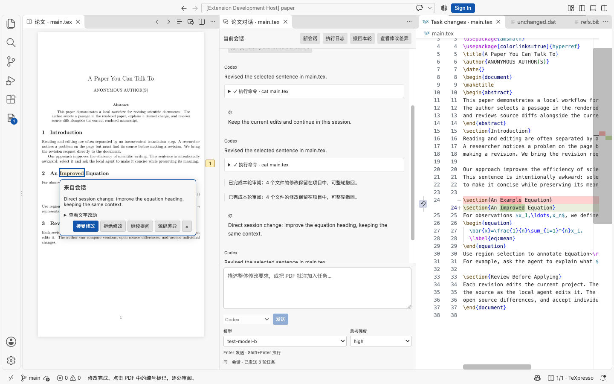
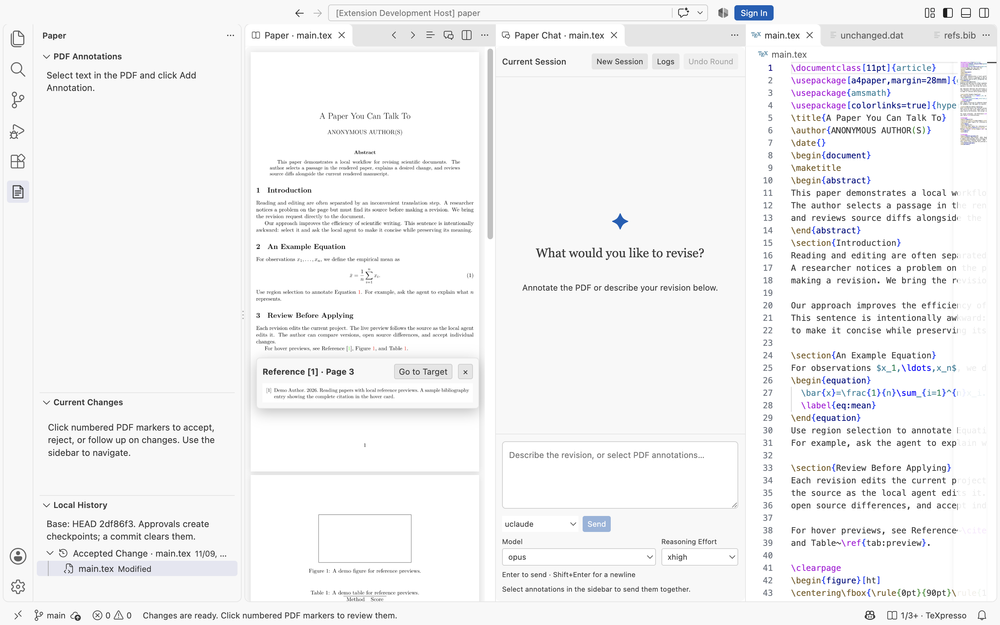

# PDF Local Copilot

[English](README.md) | 简体中文

在 VS Code 的 PDF 上批注，用本机 Codex / Claude CLI 直接修改当前项目，并在源码 Diff 与当前 PDF 中审阅结果。

交互工作流受到 [Papilot](https://github.com/PapilotAI/papilot) 启发，实时渲染基于 [TeXpresso](https://github.com/let-def/texpresso)。



截图使用内置示例论文和隔离测试环境，代理回复来自确定性测试 CLI。完整截图说明、源码构建和安装步骤见 [英文 README](README.md)。

## 安装与打开

从 [Releases](https://github.com/wyxu95/pdf-local-copilot/releases/latest) 的 **Assets** 下载与插件后端匹配的 VSIX，通过 **Extensions: Install from VSIX…** 安装。

| 项目所在的后端 | 安装包后缀 |
| --- | --- |
| Apple Silicon Mac | `darwin-arm64.vsix` |
| WSL2／Ubuntu 24.04 x86_64 | `linux-x64.vsix` |
| WSL2／Ubuntu 24.04 aarch64 | `linux-arm64.vsix` |

Windows 上继续使用 Windows 版 VS Code。先用 **WSL: Reopen Folder in WSL** 或 **Remote-SSH: Connect to Host…** 打开项目，再在该远程窗口安装对应后端的 VSIX。TeXpresso、TeX、Codex／Claude 和它们的登录、配置目录都在项目所在的后端；PDF、聊天和编辑器界面显示在 Windows。

运行 **PDF Local Copilot: Check Setup** 可查看后端系统、连接方式和工具检测结果。详细步骤见 [Windows／远程安装说明](docs/windows-remote.md)。

也可以按 [源码构建步骤](README.md#build-and-install) 构建当前平台的包，例如 Mac ARM64：

```sh
code --install-extension artifacts/pdf-local-copilot-0.8.0-darwin-arm64.vsix
```

推送与 `package.json` 版本一致的标签（例如 `v0.8.0`）会构建三种平台的包，并在所有目标成功后发布到 Releases。运行插件的后端仍需安装相应的原生库和 TeX 环境。

打开论文项目和 `paper.tex`，点击标题栏 **PDF Local Copilot: Open Paper**。TeX 在左、当前 PDF 在中间、独立的“论文对话”在右；各分组可用 VS Code 原生分隔线调整宽度。

代理在真实项目目录启动，直接读写项目文件。发送前保存当前编辑，PDF 增量渲染同一份工作稿。原生 Diff 的修改侧也是这个真实文件，可直接编辑。

已有 PDF 可通过 **Open With… → Paper PDF Annotations** 打开，主文件根据同名 TeX 或 `% !TeX root = …` 识别。

## PDF 批注与任务队列

- 鼠标悬停在引用编号、Figure 或 Table 的链接编号上，可预览当前稿件中的参考文献条目、图表及题注。移入弹窗可继续查看和滚动，移出或按 Escape 关闭；点击编号或 **Go to Target** 跳转到目标页。预览依据文档内部链接，通常由 `hyperref` 生成。
- 同组引用中的每个编号分别命中对应条目。预览保持正文当前的显示比例，整行宽的内容按整行宽展示；编辑器较窄时可在弹窗内横向滚动。
- 弹窗区域根据显示尺寸和屏幕像素密度重新渲染，支持 Retina 屏；放大后会按新尺寸生成清晰预览。
- 页面适配可用宽度并裁掉左右空白，保留图表；多页连续滚动，页间距为 5px，支持放大和缩小。
- Ctrl＋左键点击 PDF，跳到最近正文对应的源码；macOS 同时支持 Cmd＋左键。TeX 原生右键菜单中的 **Go to PDF Location** 提供正向同步。
- 选中文字后点击 **Add Annotation**，在选区下方填写意见；区域选择可框选公式或图片。
- 文本选区使用统一底色；`tt`、`ff`、`ffi` 等字体连字可正确复制为普通字母。
- 重载后按原选中文字跨页恢复批注位置，兼容断行连字符和字体连字。原文已删除的批注保留在侧栏，标记为“待重新定位”。
- 批注支持多行和 Ctrl/Cmd+Enter 保存；点击空白处保存文字并收起，编号可重新打开意见。
- 批注中的 **Send Task** 会保存并直接提交这条意见，使用当前代理、模型和思考强度；代理忙时排入同一会话。侧栏复选框可组合多条批注和总体要求，再按 **Enter** 或点击 **Send**；**Shift+Enter** 换行，支持输入法组合输入。
- “PDF 批注”标题栏的双勾按钮用于全选待处理批注，发送按钮将已勾选批注连同聊天草稿、模型和思考强度一起发送；运行期间会加入当前会话队列。
- 运行期间可继续准备并发送下一轮。各轮在同一个 CLI 会话中顺序执行。

聊天实时展示代理回复、工具调用、命令输出和执行状态，工具详情可展开。**Logs** 打开完整原生日志。关闭聊天页后，可通过 **Paper Chat and Task Queue** 重新打开并继续原会话。



每轮提示词会提及 **SE-paper-revising**，要求代理先读取配置目录下的 `skills/paper-review/SKILL.md`，再按作者的批注范围修改。Codex 使用 `CODEX_HOME`（默认为 `~/.codex`）；Claude 使用对应的 `claude_config_dir`，例如 uclaude 的 `~/.claude-uni`。作者的明确要求优先，技能不可用时会要求代理说明并继续处理本轮请求。

## 审阅与批注来源

“本次修改”中的文本条目统一打开 VS Code 原生 Diff，定位并选中对应修改。TeX 条目还会同步定位、高亮当前 PDF；Bib、Markdown 和代码文件在对应 Diff 中审阅。二进制文件使用 VS Code 支持的差异视图。

“本次修改”以本轮开始前的工作稿为对照。每轮代理任务使用新的审阅基线和计数，CLI 会话继续保留。本地历史保留已同意的修改节点。

点击修改会先打开源码差异，再复用已有 PDF 定位。高亮根据当前源码的修改范围与 PDF 文字对齐，支持多行、跨页、引用命令和批注宏；已接受的修改会从定位计算中移除。无法映射到可见文字的修改保留源码审阅入口。

源码跳转和 Diff 优先复用已有源码标签所在的编辑器组，包括暂未激活的 `paper.tex` 标签。当前聊天焦点保持独立。

从 Git“更改”、资源管理器等原生入口打开文件或差异时，落入论文对话组的标签也会转到源码组；聊天标签、草稿和会话继续保留。

条目复选框用于选择修改，文件复选框可选择整个文件。点击标题栏的勾形按钮 **Accept Selected Changes** 后，所选条目及对应 PDF 高亮才会清除。修改列表遵循项目的 Git 忽略规则，并过滤 LaTeX 自动生成的编译文件。

PDF 右侧的修改气泡关联本轮要求：

- 批注发起的修改展示原批注、原选中文字和改动内容。
- 直接从聊天发起的修改标为 **From Conversation**，展示当轮要求。
- 卡片提供 **Accept Change、Reject Change、Follow Up、Source Diff**。点击外部可收起。
- 代理完成一轮后，原批注和原文选区高亮默认收起；修改气泡继续提供来源批注和审阅操作。编号优先放在选区斜上方，避开正文及其他编号。
- 接受修改后，该条目从待处理列表移除，相应 PDF 高亮、气泡及原始批注标记收起。仍有未接受修改的文件和条目继续显示；全部接受的文件组收起。原批注作为来源保留在审阅记录中。
- **Follow Up** 将来源上下文带回当前会话的待发送区，可补充要求后发送。

文本 Diff 的对照内容会随接受操作更新，仅突出尚未接受的部分；撤回使用的原始备份继续保留。

**接受** 确认保留已写入项目的改动；**Reject** 立即恢复那一处内容。**Finish Review** 保存记录并结束审阅；**End Review** 保留当前工作稿及差异记录。后续任务继续使用同一个 CLI 会话。

**Undo Round** 恢复该轮改动的文件，包括新增和删除的文件。撤回前会检查文件哈希，以保留后续编辑。原生编辑器的未保存内容可先保存，再完成审阅或撤回。

**New Session** 保持可点击，执行、排队或待审阅状态会给出具体提示；满足条件后显式重置上下文。

## 本地修改历史

在 **Current Changes** 中点击勾按钮同意修改后，**Local History** 会生成一个节点；一次批量同意对应一个节点，只记录已同意的部分。展开节点后点击文件，在源码组临时打开当时的只读 Diff，当前工作稿、PDF 和代理继续使用最新内容。普通保存、仅勾选复选框、代理完成和拒绝操作均不会创建节点。

历史以当前 Git HEAD 为起点，遵循项目忽略规则并过滤编译产物。每次 commit 后，旧节点、对应差异文件和打开的旧历史 Diff 自动清理；剩余修改在再次同意时生成新节点。文本仅保存差异片段，二进制修改保存变动内容。记录位于项目 `.pdf-local-copilot/history/`。旧版自动保存节点会移入该目录的归档，commit 后一并清理。

## 项目内存储与迁移

项目的 `.pdf-local-copilot/` 保存：

| 路径 | 内容 |
| --- | --- |
| `tasks/<id>/task.json` | 文件哈希索引和 CLI 会话信息 |
| `tasks/<id>/before/` | 发生变化的文件的修改前内容 |
| `tasks/<id>/review.json` | 差异片段、审阅决定、来源批注和会话要求 |
| `applications/` | 撤回记录，引用旧内容并校验当前文件哈希 |
| `history/` | 自上次 commit 起的本地历史节点、文本差异和变动的二进制内容 |
| `conversations/` | 聊天、待发送意见、排队任务和模型设置 |
| `archives/` | 旧版未应用提案的改动文件及未保存内容 |
| `images/` | 批注区域截图 |
| `build/` | 当前完整编译结果、SyncTeX 和编译缓存 |

未修改文件只记录哈希。旧内容在文件第一次变化时写入备份，下一轮使用新的差异记录，代理的工作目录始终是实际项目。

从 0.4.x 升级后，插件以当前项目文件为工作稿，将旧提案按改动文件归档到 `archives/`，保留会话 ID。旧临时文件的干净编辑器会切回项目文件；成功迁移且编辑器已释放的旧任务缓存会清理。未保存内容随提案归档，仍在编辑的旧标签会保留。

## 代理、模型与思考强度

默认 Codex、Claude Code 与自定义代理并列显示。右侧代理下方可选择模型和思考强度，也可通过 **Other Model…** 输入模型名。每轮发送时保存所选参数，运行期间可为下一轮调整；选择“默认”沿用 CLI 设置。

Codex 模型选项读取本地模型缓存，Claude 模型选项包含常用别名与该配置目录中的模型。[Codex 参数说明](https://learn.chatgpt.com/docs/config-file/config-reference)，[Claude 参数说明](https://code.claude.com/docs/en/model-config)。

选择 **＋ Add Claude Agent…**，填写名称与 `claude_config_dir`，例如 `uclaude` 和 `~/.claude-uni`。也可在用户设置中配置：

```json
{
  "pdfLocal.agents": [
    { "name": "uclaude", "type": "claude", "claude_config_dir": "~/.claude-uni" }
  ],
  "pdfLocal.codexPath": "codex",
  "pdfLocal.claudePath": "claude"
}
```

配置目录使用与终端一致的路径；Claude 的认证存储会区分符号链接路径与链接目标。自定义代理的可选 `command` 字段可指定可执行文件。账号配置在会话开始时固定，模型与思考强度可在后续轮次调整。

## 实时渲染与完整构建

需要 VS Code 1.96+、TeX Live / MacTeX（含 latexmk、SyncTeX，以及项目使用的 BibTeX / Biber）和至少一个本地代理。

默认实时渲染使用 TeXpresso 自带的修改版 XeTeX（`texpresso-xetex`），包括未保存编辑；[官方设计说明](https://github.com/let-def/texpresso#design)。新页面解码完成后与文字层一起替换，连续更新保持阅读宽度。

完整构建由 `latexmk -pdfxe` 处理引用、文献和目录。主文件的 `% !TeX program = pdflatex` 或 `lualatex` 可选择其他引擎，通过完整构建刷新 PDF。构建读取项目 `.latexmkrc`，Problems 和 Output 提供诊断。

完整构建前的额外步骤可配置为：

```json
{
  "pdfLocal.buildSteps": [
    { "command": "python3", "args": ["scripts/make_figures.py"] }
  ]
}
```

参数中的 `${workspaceFolder}` 指向真实项目。

## 开发与验证

```sh
npm ci
npm run native:build
npm run check
npm test
npm run test:ui
npm run package
PDF_COPILOT_VSIX=artifacts/pdf-local-copilot-0.8.0-darwin-arm64.vsix npm run test:ui
```

UI 测试使用隔离的 VS Code 配置与真实 TeXpresso / TeX Live，覆盖真实目录写入、差异备份、旧任务迁移、TeX Diff 与 PDF 联动、其他文本 Diff、批注来源／清理／追问、整轮撤回和连续会话。截图在 `output/playwright/`。

当前原生包链接本机 Homebrew 库；其他机器可从源码构建。TeXpresso 固定在 [VS Code 维护分支](https://github.com/DominikPeters/texpresso/tree/vscode) 的 `df8b0941ef19b36377014d18a9a264f3591280b1`，附加字符坐标和 PDF 内部链接补丁。交互参考 [Papilot](https://github.com/PapilotAI/papilot)，许可证见 `THIRD_PARTY_NOTICES.md`。

## 致谢

感谢 [Papilot](https://github.com/PapilotAI/papilot) 团队提出围绕 PDF 批注进行 AI 论文修改的交互方式。感谢 [TeXpresso](https://github.com/let-def/texpresso) 及其贡献者提供增量渲染引擎，以及 [DominikPeters 的 headless 分支](https://github.com/DominikPeters/texpresso/tree/vscode) 提供本插件使用的基础版本。我们保留固定上游版本与字符坐标、PDF 链接补丁，具体集成位置见 [TeXpresso 集成说明](docs/texpresso.md)。
