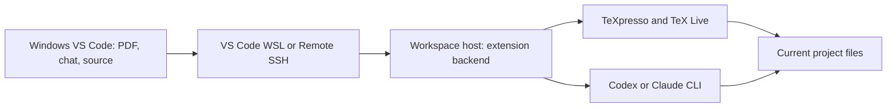

# Windows, WSL2, and Remote SSH

Use the normal **Windows installation of VS Code**. The extension runs beside
the project in its workspace extension host, while the PDF, chat, source editor,
and review trees appear in the Windows window.



| Workspace host | Release package | Tools and configuration |
| --- | --- | --- |
| WSL2 Ubuntu 24.04, x86_64 | `linux-x64.vsix` | Inside that WSL distribution |
| WSL2 Ubuntu 24.04, aarch64 | `linux-arm64.vsix` | Inside that WSL distribution |
| SSH to an Apple Silicon Mac | `darwin-arm64.vsix` | On the Mac |
| SSH to Ubuntu 24.04, x86_64 or aarch64 | Matching Linux VSIX | On the Linux host |

The package filename starts with `pdf-local-copilot-<version>-`. Choose the
package for the **workspace host**, including its CPU architecture. Run
`uname -m` in the remote terminal to check the architecture.

## Install for WSL2

1. Install WSL2 and Ubuntu 24.04 from a Windows PowerShell terminal:

   ```powershell
   wsl --install -d Ubuntu-24.04
   ```

2. Install VS Code on Windows and Microsoft's **WSL** extension. Open your project
   with **WSL: Reopen Folder in WSL**. The remote indicator should show **WSL: Ubuntu-24.04**.
   A project under `~/work/` keeps editing and compilation in the Linux filesystem.

3. In the VS Code WSL terminal, install the runtime dependencies and TeX tools:

   ```sh
   sudo apt-get update
   sudo apt-get install -y git latexmk texlive-xetex texlive-latex-extra \
     texlive-bibtex-extra biber mupdf-tools libsdl2-2.0-0 liblept5 libtesseract5
   ```

   Install the fonts and classes used by your paper. For ACM papers and Libertine
   fonts, these Ubuntu packages are useful:

   ```sh
   sudo apt-get install -y texlive-publishers texlive-fonts-extra fonts-linuxlibertine
   ```

4. Install and authenticate your chosen Codex or Claude Code CLI **inside WSL**.
   Check it from the same terminal with `codex --version` or `claude --version`.

5. Download the matching Linux VSIX from [Releases](https://github.com/wyxu95/pdf-local-copilot/releases/latest).
   While the WSL window is connected, run **Extensions: Install from VSIX…** and
   select that file. Confirm the extension appears in the **WSL** installed category.

6. Run **PDF Local Copilot: Check Setup**, then open `paper.tex` and run **Open Paper**.

VS Code manages the local connection to WSL. TeXpresso communicates with the
backend through its local process streams, and the backend sends rendered frames
to the VS Code webview. The project, annotations, agent session, and local history
stay in the workspace filesystem.

## Connect Windows VS Code to a Mac or Linux machine

Enable SSH access on the workspace machine and install Microsoft's **Remote - SSH**
extension in Windows VS Code. Run **Remote-SSH: Connect to Host…**, open the remote
project folder, and install the VSIX matching that host in the connected window.
On a Mac, SSH access is configured through **Remote Login** in System Settings.

Install TeXpresso's runtime dependencies, TeX Live or MacTeX, and the selected
agent CLI on the remote machine. The extension's bundled native binaries are used
on that machine. The existing Mac prerequisites are in the main README; Ubuntu
24.04 uses the packages above.

For example, with Windows VS Code connected to a Mac:

- `paper.tex`, its current PDF, and `.pdf-local-copilot/` belong to the Mac project.
- Codex or Claude runs on the Mac and edits that same project.
- PDF selections, annotations, chat, diffs, and source navigation are displayed
  in the Windows VS Code window.

## Agent profiles and paths

Run **Preferences: Open Remote Settings** to configure paths for that endpoint.
`pdfLocal.codexPath`, `pdfLocal.claudePath`, `pdfLocal.texpressoPath`, and custom
agent commands refer to paths on the workspace host.

The same rule applies to `claude_config_dir`. For a WSL `uclaude` profile,
`~/.claude-uni` means the WSL user's home directory; over SSH it means the remote
user's home. Authenticate that profile on the same host. Agent sessions and
credentials belong to their configured host and profile.

## Verification

**Check Setup** reports the backend operating system, architecture, connection,
and detected commands in the native Output panel. On a WSL connection it should
report `linux-x64` or `linux-arm64` and `wsl`; an SSH connection reports `ssh-remote`.

The release workflow builds native packages on each target architecture. Linux
integration tests cover actual TeX compilation, live rendering, bibliography
builds, source/PDF synchronization, ligature extraction, local CLI sessions,
review/undo, and paths containing spaces and Unicode.

The native Linux packages use Ubuntu 24.04 libraries. Other Linux distributions
can build from the pinned source and patches using `npm run native:build`.

References: [VS Code WSL](https://code.visualstudio.com/docs/remote/wsl),
[Remote SSH](https://code.visualstudio.com/docs/remote/ssh), and
[installing a VSIX in a remote window](https://code.visualstudio.com/docs/remote/troubleshooting#_need-to-install-local-vsix-on-remote-endpoint).
